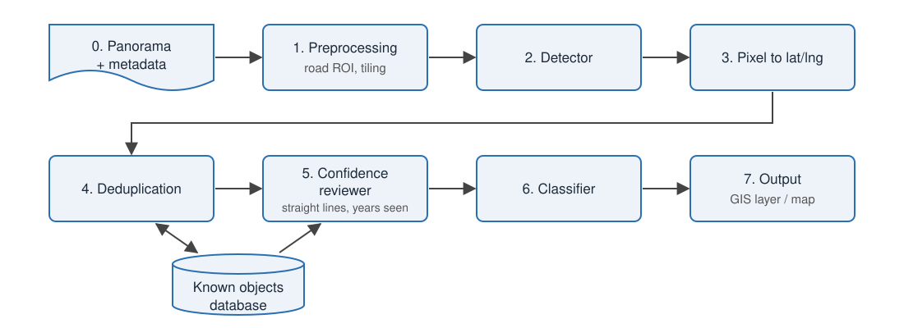
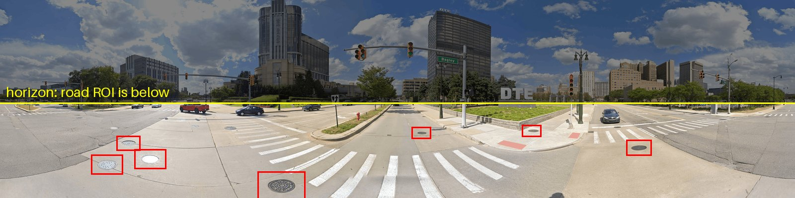
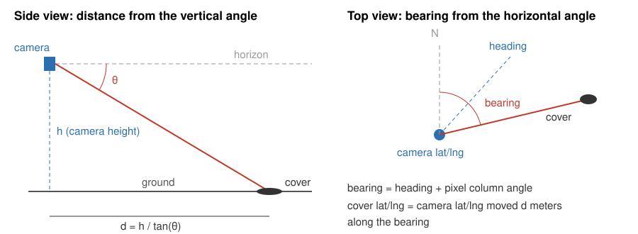
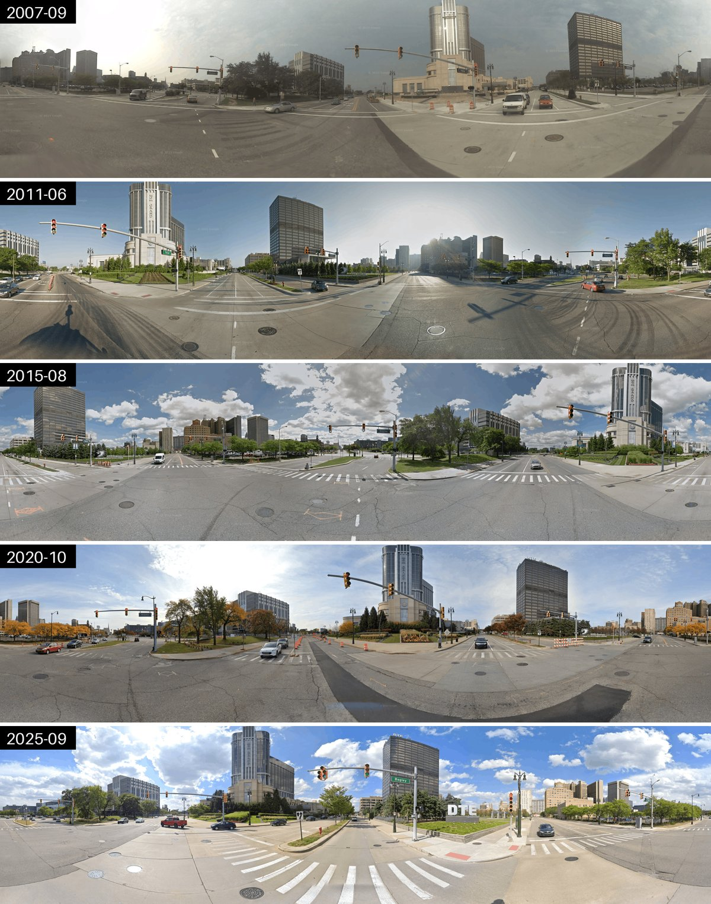
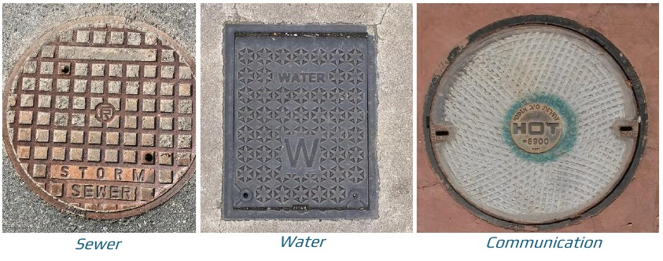
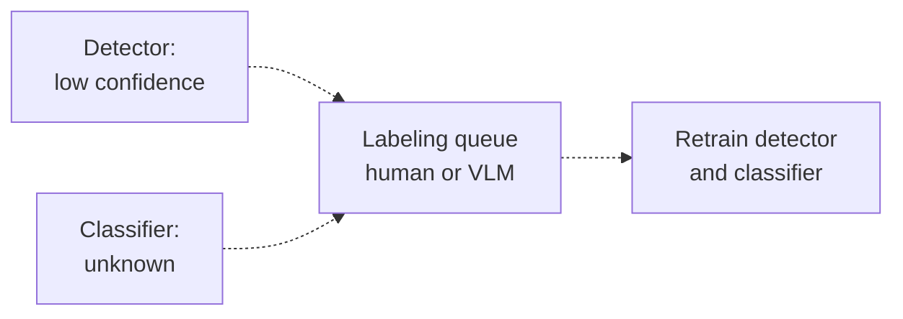

# Manhole detection and classification from Street View

**Goal:** add confidence to underground utility estimations. Detect manhole covers in
Google Street View panoramas, classify them by type, and output them as a geospatial
layer that can be compared with sensor-based estimations (US only).

**Contents**

1. [The final system](#1-the-final-system)
2. [Building the models: labeling and training](#2-building-the-models-labeling-and-training)
3. [Parameter selection](#3-parameter-selection)
4. [Evaluation](#4-evaluation)
5. [Challenges and failure modes](#5-challenges-and-failure-modes)
6. [Assumptions](#6-assumptions)
7. [Open questions](#7-open-questions)
8. [Terms](#8-terms)

## 1. The final system

| # | Module | Input | Output |
|---|---|---|---|
| 1 | Preprocessing | Image path, IPM parameters (optional) | Road ROI tiles, each with its source (image, position) |
| 2 | Detector | Batches of tiles (mixed across images for speed) | Boxes + confidence, in tile coordinates |
| 3 | Pixel to lat/lng | Detections, tile-to-image map, metadata | Lat/lng per detection + confidence |
| 4 | Deduplication + triangulation | Lat/lng list, known objects database | Same list, one entry per physical cover, location refined from all its views |
| 5 | Confidence reviewer | Deduplicated list, known objects database | Same list + line and years-seen scores |
| 6 | Classifier | IPM crop per detection | Same list + type label (or "unknown") |
| 7 | Output | Full list | GIS layer / map overlay, final confidence |

### 1.1 Preprocessing

The road is below the horizon, so we keep only that part of the image. This gives fewer
false positives and a shorter runtime. If the ROI is too large for the detector, we tile it
instead of resizing, so that small, distant covers are not lost.

*Sample panorama, Detroit 2025. Red boxes: covers marked by hand for illustration.*

IPM of the ROI (see [Terms](#8-terms)) is optional. Compare detection on the raw ROI and
on the IPM view; YOLO perspective and shear augmentations may make it unnecessary.
(NOTE: fact checking showed that the YOLO transformations cannot simulate panoramic
distortion, so the augmentations need to be re-examined.)

### 1.2 Detector

One class: manhole cover. Ultralytics YOLO fine-tuned on our labels: fast, easy to
fine-tune, and familiar. License: AGPL-3.0, and models trained with it are AGPL too.
Closed commercial use needs a paid Enterprise license. Fallback with a permissive license:
RF-DETR (Apache 2.0 for the Nano to Large detection sizes).

### 1.3 Pixel to lat/lng

- The panorama is equirectangular (2:1 tiles in the Street View Tiles API), so each pixel
  maps directly to an angle. Caution: the metadata says 13312 x 6656 or 16384 x 8192
  (2:1), but the sample files are 4:1 strips at 1/4 of the width and 1/8 of the height:
  360° x 90°, ±45° around the horizon (checked on the samples: the far ends of the
  streets are on the middle row). The vertical angle per pixel must come from the real
  image, not the metadata size, or every distance is wrong.
- Vertical angle below the horizon + camera height + flat ground → distance `d`.
- Horizontal angle + `heading` → bearing.
- Camera lat/lng moved `d` meters along the bearing → cover lat/lng.
- **Sanity check:** a silent alert (the run continues) when a cover lands outside the US.
  It points to a bug in the calculation or bad raw data.
- **Size check:** US covers are about 0.55 to 0.9 m across (22 to 36 in; no national
  standard, each agency sets its own). A detection whose box size, at its computed
  distance, is far outside this range is suspect: lower its confidence.
- **Camera configuration:** the configuration with which the images were taken is
  unclear. What we know:
  - Camera height: about 2.5 m (not an official figure; may differ between camera
    generations).
  - Camera lat/lng: the GPS accuracy is not published.
  - `heading`: compass direction, clockwise from north (Street View Tiles API). Which
    image column it maps to is not documented.
  - `tilt` / `roll`: degrees, `tilt` 90 = level. They are corrections already applied:
    the horizon is on the middle row in the samples.
  - A small angle error grows fast with distance: with a 2.5 m camera, a 0.5° error
    moves a cover about 0.4 m at 10 m, about 1.5 m at 20 m, and about 3.5 m at 30 m.

  Combining information from several images lowers this uncertainty (triangulation,
  next).
- **Triangulation (main location method):** panoramas are taken every 10 to 20 m, so
  most covers are seen in several of them. Intersect the bearings from all views of
  the same cover. This needs neither the camera height nor flat ground, and the GPS
  error between neighbor panoramas is smaller than the absolute error. The single view
  estimate is still used to match the views of one cover (module 4), and as the
  location of covers seen only once (with a lower confidence).

### 1.4 Deduplication and known objects database

The same cover appears in nearby panoramas and in panoramas of the same place from
different years.

*All five samples are the same intersection, 2007 to 2025: different cameras, headings,
seasons, and the road was repaved by 2020.*

- Covers can't overlap and have a minimum distance between them, so detections closer
  than a radius are one cover. Keep the highest confidence one.
- Search per region with a KD-tree (SciPy `cKDTree`), so parallel streets are never
  compared. Convert lat/lng to meters first if needed.
- A **known objects database** (per region, to stay small) stores each cover with its
  location, type and confidence. New detections are matched against it.
- A cover seen in several years gets a higher confidence. A cover seen once may be a
  false positive, or it was removed or paved over.

### 1.5 Confidence reviewer

Adds two confidence scores to each cover:

- **Straight lines:** utility lines mostly run straight. Fit lines through the covers of
  a small area (multi-model fitting, sequential RANSAC for example). A cover on a line
  with others gets a higher score. This is the weakest assumption in the system: it may
  add noise instead of clarity.
- **Years seen:** from the known objects database. A cover seen at the same place in
  several years gets a higher score.

### 1.6 Classifier

*Examples given for one region. They show local conventions, not a fixed label set.*

- **Problem type:** semi-supervised, open-set classification. A few labeled examples
  per region, the label set may grow, and "unknown" is a valid output. Semi-supervised:
  the unlabeled crops are clustered, and the few labeled examples label the clusters
  (see 2.4).
- **Method:**
  1. Embed each crop with a pretrained image encoder (for example ResNet without its
     last layer). Run OCR in parallel: text such as "WATER" or "SEWER" is a strong
     signal.
  2. Assign the label of the nearest given examples (kNN or class prototypes).
  3. Crops far from all examples and clusters are outliers: label "unknown" and send to
     review.
- Regions: one classifier for all regions, or one per region. Decide after seeing the
  data.

### 1.7 Output

- Format: GeoJSON (RFC 7946): one point per cover, WGS84, coordinates in [lng, lat]
  order, with type, provider and confidence as properties. GIS tools (QGIS, ArcGIS) and
  web maps both read it, so one file serves both. For very large layers: GeoPackage.
- A final confidence per cover (detector, years seen, line score, classifier), shown on
  the map, for example as color.
- A provider dictionary converts the label to what users want to see: type only, or type
  plus provider.

### 1.8 Active learning loop

The only training part inside the running system. Low confidence detections and
"unknown" covers go to a labeling queue (human or VLM). New labels retrain the detector
and the classifier.

## 2. Building the models: labeling and training

### 2.1 Dataset setup

- **Splits by location** (street, neighborhood or city), never by image: the same place
  appears in many panoramas and years. Same `panoId` never in two splits.
- **Test set** from places not seen in train or validation (other cities or states).
- **Balance** seasons (`date`) and locations (`lat`/`lng`).
- **Daylight only:** not a real-time system, so night images are not needed. `date` has
  no time of day, so sample along each capture sequence to cover different hours.

### 2.2 Detector labels

| Case | Approach |
|---|---|
| Labels exist | Train directly. Choose what to label next by model uncertainty (active learning). |
| No labels | Bootstrap: an open-vocabulary detector (Grounding DINO, YOLO-World, YOLOE; "manhole" is already an LVIS class, so the LVIS-trained ones may detect covers directly) proposes boxes; a VLM answers "Is this a manhole cover? yes / no / unsure" on each crop; humans check samples per cluster and outliers. Then train our own detector. |

Why not keep the bootstrap as the final system: open-vocabulary detectors and VLMs are
slow and costly per image, and hand-written filter logic breaks on edge cases as the data
grows. Classical shape detection (circle/ellipse detection, Hough transform for example,
and edge detection) is a fallback, not the main path.

### 2.3 Augmentations

- Distortion: covers at different positions in the panorama look different.
- Mirroring: yes. Rotation: only small, so images still look real.
- Lighting: brightness and color, for weather and time of day.
- Occlusion: Cutout / Random Erasing (cut out patches; cars and people cover manholes).
  Ultralytics `erasing` is for classification only, so for the detector use
  Albumentations `CoarseDropout`.

### 2.4 Classifier labels

- Cluster the crop embeddings, see where the given examples land, label each cluster
  from a few samples (human or VLM).
- Later, with enough labels: one YOLO model with a class per cover type, which replaces
  the separate classifier.

## 3. Parameter selection

Done per module, after the first iteration on real data. Not in the current scope.

- **Detector confidence threshold:** sets the FP / FN balance. A class that is more
  sensitive to FPs can get a higher threshold.
- **NMS IoU:** default, unless a problem shows up. Covers are far apart.
- **Tile size and input resolution:** depend on the data.
- **Deduplication radius, line tolerance:** may follow construction standards.
- **Outlier threshold:** start with defaults.

## 4. Evaluation

| Level | What |
|---|---|
| Models | Validation and test sets per model. One confusion matrix for detector + classifier, with "missed" and "false detection" rows next to the type confusions. |
| Logic | Unit tests, one per edge case found. |
| System | Compare with real-world truth, if available: a known utility line and its covers, or covers mapped by walking a street. |

Recall or precision first? If covers are a proxy for the utility line, missing a few is
fine as long as the line is right. If covers are the goal, recall matters more.

Sensor estimations can be weak labels only if the system is not meant to add confidence
to them. Otherwise using them is leakage.

## 5. Challenges and failure modes

**Detection and location**

- Panorama distortion; different cameras and setups across years.
- No ground truth for the final goal (the utility line).
- Small angle or height errors grow into meters on the ground, more with distance.
- The straight line assumption may be wrong.

**Classification**

- Dirty, worn or partly covered covers.
- Covers with no visible marking.
- Different utility types with similar covers in the same region.
- Rare providers with very few examples.

## 6. Assumptions

| Assumption | Reason |
|---|---|
| US only | Stated in the task. |
| Daylight images are enough | Not real time; we choose which images to use. |
| The road is below the horizon line, at about the same height in all panoramas | Seen in the samples. |
| Panoramas are equirectangular; `tilt` is in degrees, 90 = level | Metadata is 2:1 (13312 x 6656 or 16384 x 8192), as in the Street View Tiles API, which also defines `tilt` (see 1.3). |
| The sample PNGs are a 4:1 strip of the full panorama, ±45° around the horizon | Sample files are full width / 4 and full height / 8 (4096 x 1024 or 3328 x 832), so 360° x 90°; the horizon is on the middle row in the samples. |
| Camera height is about 2.5 m, ground near the camera is flat | Needed for distance from one view only (covers seen once, and matching views); triangulation does not need it. |
| Utility lines mostly run straight | Basis of the line checker. |
| Covers don't overlap and have a minimum spacing | Basis of deduplication. |
| Too few labeled cover examples per region to train a classifier | Stated in the task. |

## 7. Open questions

**For Exodigo**

- Are the covers the goal, or a proxy for the utility line? This sets recall vs
  precision.
- Is any real-world ground truth available?
- Are the classes utility types only, or also providers?
- Will this system be used to confirm the sensor estimations?
- The sample files are 4:1 strips, while the metadata says 2:1. Which vertical field of
  view do the API images cover, and can we get the full panorama?

**To verify (fact finding)**

- Camera height and camera lat/lng accuracy (not published, see 1.3).
- Which image column `heading` maps to (center or left edge).
- Zero-shot classifiers (OpenCLIP, SigLIP 2): names checked; how well they classify
  covers needs a test on real crops.

## 8. Terms

- **IPM (inverse perspective mapping):** reprojects the road part of the panorama to a
  bird's-eye view (a view from above). In this view a round cover looks round again, and
  pixel distances on the road are close to distances in meters.
